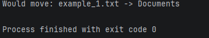
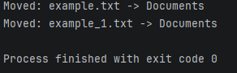

# 📁 Automatic File Organizer

**A simple Python tool that automatically organizes files into folders based on their extensions.**


---

## ✨ Overview

Automatic File Organizer is a Python project designed to keep folders clean and organized.

It automatically detects file extensions, creates category folders, and moves files into the correct locations.

It also includes a preview mode, duplicate filename protection, and activity logging.

## 🚀 Features

- 📂 Automatic file organization
- 🖼️ Categorization by file extension
- 🛡️ Duplicate filename protection
- 👀 Preview mode before moving files
- ⚙️ Custom target folder selection
- 📝 Activity logging
- ❗ Error handling for invalid folder paths

## 📸 Screenshots

### Preview Mode
See what the program plans to move without changing any files.



### Move Mode
Files are automatically moved into their corresponding folders.



## 📁 Supported File Types

| Category | Extensions |
|---|---|
| Images | `.jpg`, `.jpeg`, `.png`, `.gif` |
| Documents | `.pdf`, `.docx`, `.txt`, `.doc` |
| Audio | `.mp3`, `.wav`, `.flac` |
| Videos | `.mp4`, `.mov`, `.avi` |
| Archives | `.zip`, `.rar`, `.7z` |
| Others | Other file extensions |

## 🛠️ Installation

**1. Clone the repository**

```bash
git clone https://github.com/XereX056/automatic-file-organizer.git
```

**2. Enter the project folder**

```bash
cd automatic-file-organizer
```

**3. Run the program**

Python 3.8 or newer is recommended. No external packages are required.

##